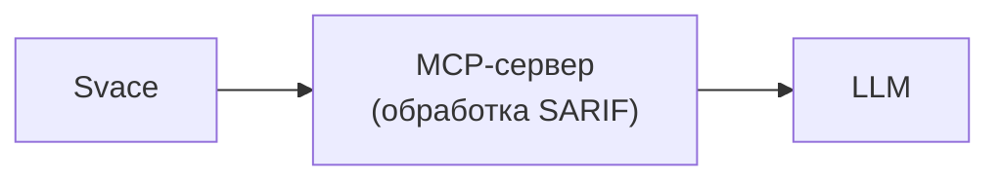

Определить сценарии использования
 Определить состав обрабатываемых данных
 Спроектировать внутреннюю модель результатов SAST
 Определить список операций MCP-сервера
 Описать способ хранения данных
 Описать границы системы
 Согласовать архитектуру

 ## 1. Сценарии использования
 
 - Все уровни ошибок
 - Только критические ошибки (Critical/Major)
 - Проверка комментариев ревьюеров (Soft Check)
 - Проверка комментариев ревьюеров (Hard Check)
 - Дописывание LLM неоткомментированных findings.

## 2. Состав обрабатываемых данных

 - Входные данные: SARIF в формате JSON. ( команда `svacer sarif2 export --out-` )
 - Выходные данные: Список словарей полей file, line, level, message, rule_id, trace.

## 3. Внутренняя модель результатов SAST
```json
{
    "file": ".build/deflate.c",          
    "line": 287,                          
    "level": "error",                    
    "message": "Memory areas...",         
    "rule_id": "SvEng.CXX.BUFFER_OVERLAP",
    "trace": [                            
        {"file": "...", "line": ..., "message": "..."},
        ...
    ]
}
```
## 4. Список операций MCP-сервера
https://modelcontextprotocol.io/specification/2025-06-18/server/tools

Tools:
1. `analyze_findings` (все/критичные)
2. `validate_comments` (качество комментариев)
3. `complete_findings_review` (генерация оставшихся комментариев после ревьюера)

Promts:
1. all_errors_audit (Все уровни ошибок)
2. critical_errors_audit (Только критические ошибки)
3. soft_check_comments (Проверка комментариев — Soft)
4. hard_check_comments (Проверка комментариев — Hard)
5. catch_up_report (Дописывание отчета)
   
## Высокоуровневая архитектура



## Декомпозиция компонентов


## Потоки данных

### Фаза 1. Выбор Промпта
1. Пользователь в интерфейсе хоста выбирает промт
2. Хост передает LLM текст промпта.
3. LLM анализирует текст и вызывает инструмент + параметры
4. LLM инициирует вызов инструмента через `server.py`

### Фаза 2. Подготовка данных
5. `server.py` принимает вызов и передает управление в `core.py`
6. `core.py` проверяет кэш
7. core.py запускает подготовку данных:
   - `svacer_client.download()`;
   - `parser.load_sarif()`;
   - `normalizer.normalize_severity()`;
   - `analyzer.py` (фильтрация, поиск неоткомментированных ошибок и т.д.)
8. `core.py` сохраняет список в кэш
9. `core.py` извлекает срез [offset : offset+limit] и формирует ответ, добавляя метаданные:
    - `total_count` (общее число записей)
    - `has_more` (флаг, есть ли еще данные) 
    - `next_offset` (какой offset использовать для следующего шага)
11. `server.py` упаковывает этот ответ в JSON-RPC и отправляет хосту.

### Фаза 3. Обработка данных
11. LLM получает порцию данных и генерирует комментарии
12. Хост сохраняет этот текстовый ответ в общий файл отчета
13. LLM анализирует полученные метаданные: если в ответе пришел флаг `has_more: true`, она инициирует следующий вызов инструмента с параметром `offset=next_offset`
14. Хост передает этот вызов серверу
15. Serve.py передает запрос в `core.py`. `core.py` извлекает из памяти следующий срез согласно новому `offset` и возвращает его. Цикл (пункты 11–15) продолжается до момента, пока в ответе не вернется флаг `has_more: false`.

### Фаза 4. Финализация
16. Получив `has_more: false`, LLM понимает, что данные закончились, и сообщает хосту о завершении работы
17. Хост собирает единый итоговый файл

