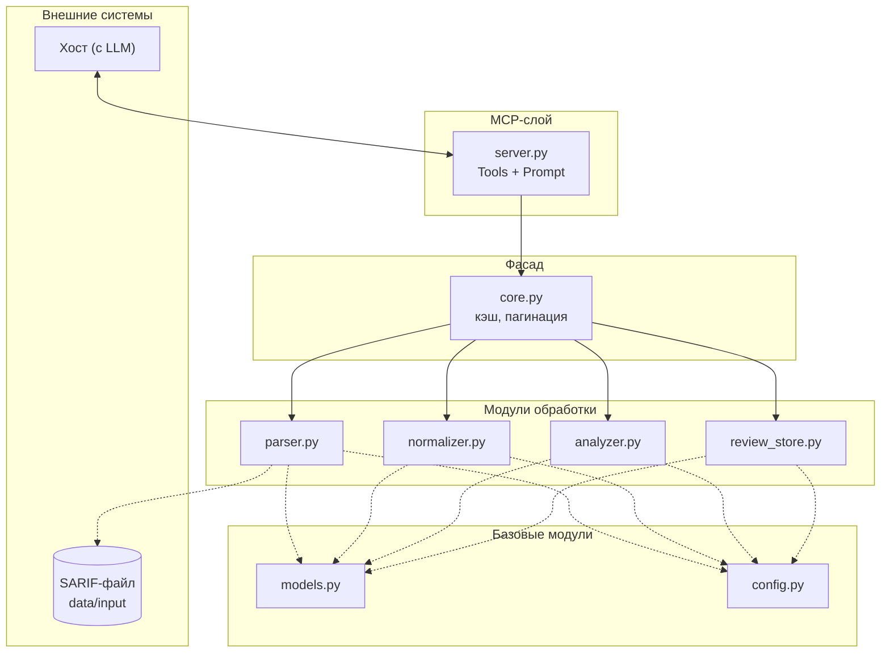

- Определить сценарии использования
- Определить состав обрабатываемых данных
- Спроектировать внутреннюю модель результатов SAST
- Определить список операций MCP-сервера
- Описать способ хранения данных
- Описать границы системы
- Согласовать архитектуру

 ## 1. Сценарии использования
 
 - Все уровни ошибок

## 2. Состав обрабатываемых данных

 Вход: один SARIF-файл (SARIF 2.1.0, JSON). Путь — `SARIF_PATH` в `config.py`
 Выход: findings + rules (в памяти) и итоговый отчёт `data/reports/<SOURCE_KEY>_full_audit.md`
 
## 3. Внутренняя модель результатов SAST
```json
{
    "finding_id": "7P6Pei16cq9IlDbvpqZ5WQ",
    "file": "/.build/deflate.c",
    "line": 287,
    "level": "error",
    "severity": "Critical",
    "status": "False Positive",
    "message": "Memory areas of 'memcpy'...",
    "rule_id": "SvEng.CXX.BUFFER_OVERLAP/SvEng.BO.65",
    "comments": [
        {
            "text": "Перекрытия не происходит...",
            "created_by": "d.kaluh",
            "created_ts": "2026-02-02T10:26:10.39938Z"
        }
    ],
    "trace": [
        {
            "file": "/.build/deflate.c",
            "line": 287,
            "message": "function call"
        }
    ]
}
```
## 4. Список операций MCP-сервера
https://modelcontextprotocol.io/specification/2025-06-18/server/tools

Tools:
1. `get_summary()` — количества по severity, статусу, наличию комментария
2. `get_results(severity, status, has_comment, has_review, rule_id, file, offset, limit)` — страница findings с фильтрами и пагинацией
3. `get_result(finding_id)` — подробная запись одной ошибки (+ trace и комментарии)
4. `get_rule(rule_id)` — сведения о правиле (имя правила, описание, CWE, критичность по умолчанию)
5. `save_reviews(records)` — вердикты LLM
6. `export_report()` — итоговый .md-отчёт из записей review_store и данных findings (finding_id, file, line, rule_id, severity, verdict, text)

Promts:
1. `full_audit`
   
## Высокоуровневая архитектура



## Потоки данных

1. Пользователь выбирает prompt `full_audit` в интерфейсе хоста
2. Хост запрашивает текст prompt у `server.py` (MCP prompts/get)
3. Хост передаёт текст LLM

**Подготовка данных**

4. `server.py` принимает вызов, извлекает имя tool и аргументы, передаёт в `core.py`
5. `core.py` определяет `SOURCE_KEY` из `config.py` и проверяет, загружены ли данные под этим ключом в память
6. Если не загружены:
   - `parser.load_sarif(SARIF_PATH)` открывает файл, читает его целиком как текст, парсит как JSON
   - `parser.parse_sarif()` строит список Finding
   - `normalizer.normalize_severity()` для каждого Finding приводит `severity` к единой шкале Critical / Major / Normal / Minor / Unknown
   - `analyzer.deduplicate()`проходит по списку findings, запоминает finding_id, при повторе оставляет первый, остальные отбрасывает
   - `review_store` загружается из `data/reviews/<SOURCE_KEY>.jsonl`. Читает JSONL-файл (если он есть) построчно, восстанавливает словарь finding_id → запись в памяти. Дальше каждая новая запись от save_reviews сразу дописывается в конец файла
   - Кэш под `SOURCE_KEY`
7. `core.py` выполняет операцию, соответствующую вызванному tool (фильтрация, пагинация, агрегация, запись), и возвращает результат в `server.py`
8. `server.py` упаковывает результат в JSON и отправляет хосту
9. LLM вызывает `get_summary()` и получает total (кол-во findings) и remaining (сколько ещё без записи в review_store)
10. Пока remaining > 0, выполнять итерацию:              
    10.1 `get_results(has_review=false, offset=0, limit=N)`  
    10.2 при необходимости get_result / get_rule  
    10.3 сформировать записи {finding_id, verdict, text}, где text — человекочитаемый анализ LLM  
    10.4 save_reviews(records) => {saved, rejected[], remaining}
11. При remaining = 0 вызвать export_report() => {path, count, verdict_counts}
12. LLM сообщает пользователю итог и путь к файлу
