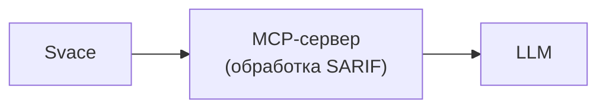
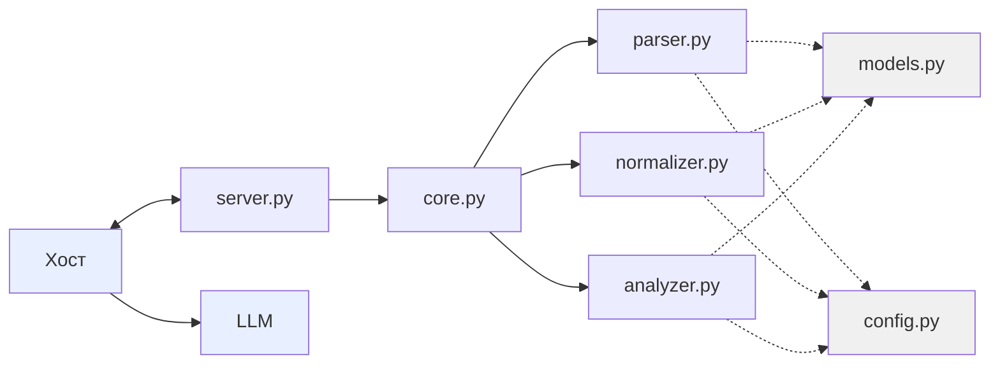

## 1. Высокоуровневая архитектура

## 2. Декомпозиция компонентов

## 3. Потоки данных

1. LLM решает вызвать get_summary()
2. Хост отправляет вызов серверу
3. server.py получает вызов
4. server.py вызывает core.get_summary()
5. core.py вызывает parser.load_sarif()
6. parser.py открывает SARIF-файл
7. parser.py читает JSON
8. parser.py создаёт список объектов Finding
9. parser.py возвращает список в core.py
10. core.py вызывает analyzer.summarize(findings)
11. analyzer.py считает сводку
12. analyzer.py возвращает словарь в core.py
13. core.py возвращает словарь в server.py
14. server.py упаковывает в JSON-RPC
15. Хост получает ответ
16. LLM получает ответ и пишет текст пользователю
