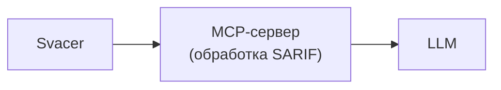
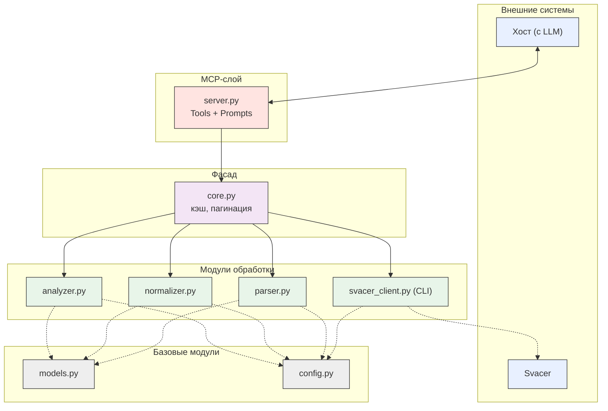

- Определить сценарии использования
- Определить состав обрабатываемых данных
- Спроектировать внутреннюю модель результатов SAST
- Определить список операций MCP-сервера
- Описать способ хранения данных
- Описать границы системы
- Согласовать архитектуру

 ## 1. Сценарии использования
 
 - Все уровни ошибок
 - Только критические ошибки (Critical/Major)
 - Проверка комментариев ревьюеров (Soft Check)
 - Проверка комментариев ревьюеров (Hard Check)
 - Дописывание LLM неоткомментированных findings.

## 2. Состав обрабатываемых данных

 - Входные данные: SARIF в формате JSON. ( команда `svacer sarif2 export --out-` )
 - Выходные данные: Список словарей полей file, line, level, message, rule_id, trace.

## 3. Внутренняя модель результатов SAST
```json
{
    "finding_id": "7P6Pei16cq9IlDbvpqZ5WQ",
    "file": ".build/deflate.c",          
    "line": 287,                          
    "level": "error",                    
    "message": "Memory areas...",         
    "rule_id": "SvEng.CXX.BUFFER_OVERLAP",
    "trace": [                            
        {"file": "...", "line": ..., "message": "..."},
        ...
    ]
}
```
## 4. Список операций MCP-сервера
https://modelcontextprotocol.io/specification/2025-06-18/server/tools

Tools:
1. `get_summary()` — количества по severity, статусу, наличию комментария
2. `get_results(severity, status, has_comment, rule_id, file, offset, limit)` — фильтры и пагинация
3. `get_result(finding_id)` — подробная запись одной ошибки (+ trace и комментарии)
4. `get_rule(rule_id)` — сведения о правиле (имя правила, описание, CWE, критичность по умолчанию)
5. `get_source_fragment(finding_id)` — фрагмент исходных данных, контекст

Promts:
1. `all_errors_audit` (Все уровни ошибок)
- Вызывает:`get_summary`,`get_results`,`get_result`,`get_rule`

2. `critical_errors_audit` (Только критические ошибки)
- Вызывает:`get_results(severity=["Critical", "Major"]`)

3. `soft_check_comments` (Проверка комментариев — Soft)
- Вызывает:`get_results(has_comment=True)`,`get_result`

4. `hard_check_comments` (Проверка комментариев — Hard)
- Вызывает:`get_results(has_comment=True)`,`get_result`

5. `catch_up_report` (Допиcывание отчета)
- Вызывает:`get_results(has_comment=False)`,`get_result`,`get_rule`
   
## Высокоуровневая архитектура



## Декомпозиция компонентов


## Потоки данных
Глоссарий:

### Фаза 1. Выбор промта
1. Пользователь в интерфейсе хоста выбирает prompt
2. Хост запрашивает текст prompt у `server.py` и получает его        
3. Хост передаёт текст LLM
4. LLM по тексту prompt вызывает tool с параметрами через хост; вызов приходит в `server.py`

### Фаза 2. Подготовка данных и обработка
5. `server.py` принимает вызов, извлекает имя tool и аргументы,
   передаёт в `core.py`
6. `core.py` берёт ключ источника (project, branch, snapshot) из      
   `config.py` и проверяет, загружены ли findings и rules в памяти
7. Если нет: проверяется файл `data/cache/<ключ>.sarif`;               
   если файла нет, `svacer_client.export_sarif()` запускает CLI
   `svacer sarif2 export` (подпроцесс, аргументы списком, пароль из
   переменных окружения) и сохраняет результат в этот файл
8. `parser.parse_sarif()` возвращает две структуры:                  
   - `findings` (finding_id = fingerprints.invariant, status, комментарии ревьюеров);
   - `rules: dict[rule_id, RuleMeta]`, связь по полному `ruleId`. `normalizer` приводит `checker_severity` к 4 значениям, `level` сохраняется. `analyzer.deduplicate()` (критерий определяется отдельно). Результат остаётся в памяти
9. `core.py` подгружает сохранённые ревью LLM из `review_store`.        
10. Обработка по tool:                                                  
    - `get_summary`: `analyzer` считает счётчики
    - `get_results`: `analyzer` фильтрует и сортирует (порядок фиксирован,
      например severity ↓, file, line); `core.py` делает срез
      [offset : offset+limit] и добавляет `total_count`, `has_more`,
      `next_offset`
    - `get_result`, `get_rule`: поиск по `finding_id` / `rule_id`, без пагинации
    - `get_source_fragment`: `source_reader` (границы доступа к исходникам ещё не определены)
11. `core.py` возвращает результат в `server.py`, тот упаковывает в JSON
    и отправляет хосту

### Фаза 3. Обработка LLM
12. LLM получает срез и метаданные
13. При необходимости вызывает `get_result` / `get_rule` / `get_source_fragment` (каждый вызов проходит фазу 2)
14. LLM формирует ревью для каждого finding порции согласно prompt.
15. LLM вызывает `save_reviews([{finding_id, text}, ...])`; `core.py` дописывает записи через `review_store`, ответ: сколько сохранено.
16. Следующая порция, если `has_more: true`:                          
    - фильтр не зависит от ревью: `offset = next_offset`;
    - фильтр `has_review=False`: `offset = 0`, так как набор сокращается по мере сохранения ревью. Возврат к шагу 5.

### Фаза 4. Финализация
17. При `has_more: false` LLM вызывает `export_report()`              
18. `review_store` собирает документ из сохранённых ревью и данных findings, пишет файл `data/reports/<ключ>_<prompt>.md` на сервере и возвращает путь, число записей и краткую сводку
19. LLM сообщает пользователю путь и итог

