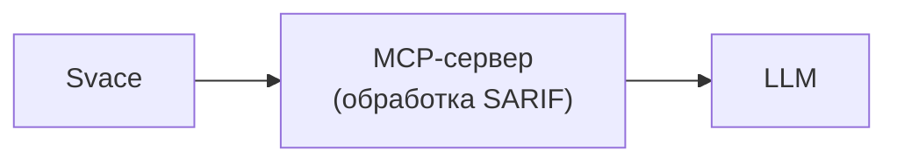
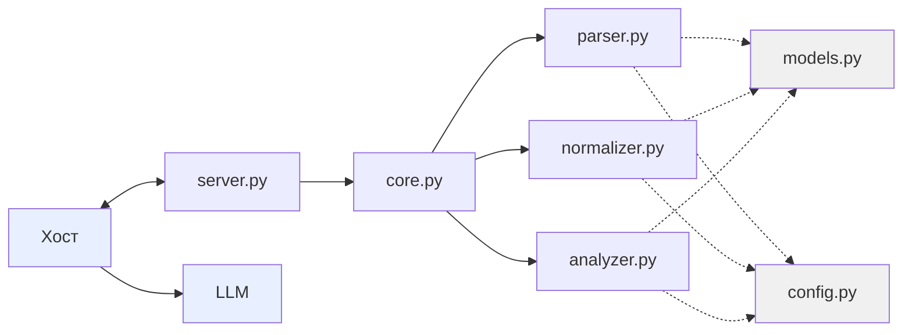

Определить сценарии использования
 Определить состав обрабатываемых данных
 Спроектировать внутреннюю модель результатов SAST
 Определить список операций MCP-сервера
 Описать способ хранения данных
 Описать границы системы
 Согласовать архитектуру

 ## 1. Сценарии использования
 
 - Все уровни ошибок
 - Только критические ошибки (Critical/Major)
 - Проверка комментариев ревьюеров (Soft Check)
 - Проверка комментариев ревьюеров (Hard Check)
 - Дописывание LLM неоткомментированных findings.

## 2. Состав обрабатываемых данных

 Входные данные: SARIF в формате JSON. ( команда `svacer sarif2 export --out-` )
 Выходные данные: Список словарей полей file, line, level, message, rule_id, trace.

## 3. Внутренняя модель результатов SAST
```json
{
    "file": ".build/deflate.c",          
    "line": 287,                          
    "level": "error",                    
    "message": "Memory areas...",         
    "rule_id": "SvEng.CXX.BUFFER_OVERLAP",
    "trace": [                            
        {"file": "...", "line": ..., "message": "..."},
        ...
    ]
}
```
## 4. Список операций MCP-сервера
https://modelcontextprotocol.io/specification/2025-06-18/server/tools

1. `analyze_findings` (все/критичные)
2. `validate_comments` (качество комментариев)
3. `complete_findings_review` (генерация оставшихся комментариев после ревьюера)

## Высокоуровневая архитектура



## Декомпозиция компонентов


## Потоки данных

1. LLM вызывает `get_summary()`
2. Хост отправляет вызов серверу
3. `server.py` получает вызов
4. `server.py` вызывает `core.get_summary()`
5. `svacer_client.download()` скачивает SARIF из Svacer
6. `core.py` вызывает `parser.load_sarif(path)`
7. `parser.py` открывает SARIF-файл
8. `parser.py` читает JSON
9. `parser.py` создаёт список объектов Finding
10. `parser.py` возвращает список в `core.py`
11. `core.py` вызывает `analyzer.summarize(findings)`
12. `analyzer.py` считает сводку
13. `analyzer.py` возвращает словарь в `core.py`
14. `core.py` возвращает словарь в `server.py`
15. `server.py` упаковывает в JSON-RPC
16. Хост получает ответ
17. LLM получает ответ и пишет текст пользователю
