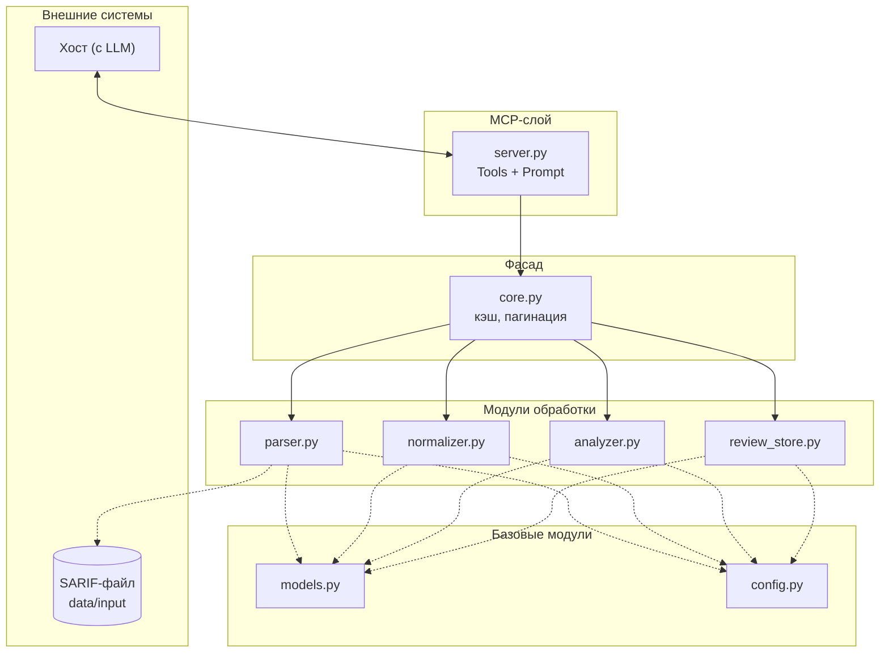

- Определить сценарии использования
- Определить состав обрабатываемых данных
- Спроектировать внутреннюю модель результатов SAST
- Определить список операций MCP-сервера
- Описать способ хранения данных
- Описать границы системы
- Согласовать архитектуру

 ## 1. Сценарии использования
 
 - Все уровни ошибок

## 2. Состав обрабатываемых данных

 Вход: один SARIF-файл (SARIF 2.1.0, JSON). Путь — `SARIF_PATH` в `config.py`
 Выход: findings + rules (в памяти) и итоговый отчёт `data/reports/<SOURCE_KEY>_full_audit.md`
 
## 3. Внутренняя модель результатов SAST
```json
{
    "finding_id": "7P6Pei16cq9IlDbvpqZ5WQ",
    "file": ".build/deflate.c",          
    "line": 287,                          
    "level": "error",                    
    "message": "Memory areas...",         
    "rule_id": "SvEng.CXX.BUFFER_OVERLAP",
    "trace": [                            
        {"file": "...", "line": ..., "message": "..."},
        ...
    ]
}
```
## 4. Список операций MCP-сервера
https://modelcontextprotocol.io/specification/2025-06-18/server/tools

Tools:
1. `get_summary()` — количества по severity, статусу, наличию комментария
2. `get_results(severity, status, has_comment, rule_id, file, offset, limit)` — фильтры и пагинация
3. `get_result(finding_id)` — подробная запись одной ошибки (+ trace и комментарии)
4. `get_rule(rule_id)` — сведения о правиле (имя правила, описание, CWE, критичность по умолчанию)
5. `save_reviews(records)` — вердикты LLM

Promts:
1. `full_audit`
   
## Высокоуровневая архитектура



## Потоки данных
