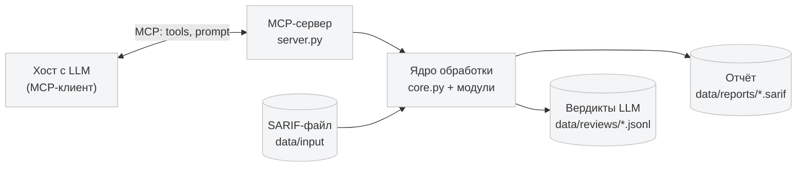

- Определить сценарии использования
- Определить состав обрабатываемых данных
- Спроектировать внутреннюю модель результатов SAST
- Определить список операций MCP-сервера
- Описать способ хранения данных
- Описать границы системы
- Согласовать архитектуру

 ## 1. Сценарии использования
 
 - Все уровни ошибок

## 2. Состав обрабатываемых данных

 Вход: один SARIF-файл (SARIF 2.1.0, JSON). Путь — `SARIF_PATH` в `config.py`
 Выход: findings + rules (в памяти) и итоговый отчёт `data/reports/<SOURCE_KEY>_full_audit.md`
 
## 3. Внутренняя модель результатов SAST
```json
{
    "finding_id": "7P6Pei16cq9IlDbvpqZ5WQ",
    "file": "/.build/deflate.c",
    "line": 287,
    "level": "error",
    "severity": "Critical",
    "status": "False Positive",
    "message": "Memory areas of 'memcpy'...",
    "rule_id": "SvEng.CXX.BUFFER_OVERLAP/SvEng.BO.65",
    "comments": [
        {
            "text": "Перекрытия не происходит...",
            "created_by": "d.kaluh",
            "created_ts": "2026-02-02T10:26:10.39938Z"
        }
    ],
    "trace": [
        {
            "file": "/.build/deflate.c",
            "line": 287,
            "message": "function call"
        }
    ]
}
```
## 4. Список операций MCP-сервера
https://modelcontextprotocol.io/specification/2025-06-18/server/tools

Tools:
1. `get_summary()` — количества по severity, статусу, наличию комментария
2. `get_results(severity, status, has_comment, has_review, rule_id, file, offset, limit)` — страница findings с фильтрами и пагинацией
3. `get_result(finding_id)` — подробная запись одной ошибки (+ trace и комментарии)
4. `get_rule(rule_id)` — сведения о правиле (имя правила, описание, CWE, критичность по умолчанию)
5. `save_reviews(records)` — вердикты LLM
6. `export_report()` — итоговый .md-отчёт из записей review_store и данных findings (finding_id, file, line, rule_id, severity, verdict, text)

Promts:
1. `full_audit`
   
## Высокоуровневая архитектура



## Потоки данных

### Фаза 0. Запуск сценария

1. Пользователь выбирает prompt `full_audit` в интерфейсе хоста.
2. Хост запрашивает текст prompt у `server.py` (MCP `prompts/get`) и передаёт его LLM.

### Фаза 1. Инициализация данных (при первом вызове любого tool)

3. LLM вызывает tool. `server.py` извлекает имя tool и аргументы и передаёт их в `core.py`.
4. `core.py` берет путь к SARIF-файлу из config.SARIF_PATH, отрезает у него расширение с помощью .stem, и использует его как ключ source_key для проверки кэша. Если данные уже загружены, происходит переход к п. 9.
5. `parser.load_sarif(SARIF_PATH)` читает файл как текст и парсит JSON. `parser.parse_sarif()` возвращает кортеж: список `Finding` и словарь `rules`.
6. `normalizer.normalize_severity()` для каждого `Finding` подставляет `severity` из правила, если текущее значение пустое или `Unknown`.
7. `analyzer.deduplicate()` оставляет первое вхождение каждого `finding_id`, повторы отбрасывает.
8. `review_store.load()` читает `data/reviews/<SOURCE_KEY>.jsonl` (если есть) и восстанавливает словарь `finding_id → запись`. Готовые данные кэшируются в памяти.
9. `core.py` выполняет операцию вызванного tool. `server.py` возвращает результат, который FastMCP упаковывает в JSON и отправляет хосту.

### Фаза 2. Классификация ошибок

10. LLM вызывает `get_summary()` и получает `total` и `remaining` (сколько findings ещё без записи в `review_store`).
11. Пока `remaining > 0`, выполнять итерацию:
    1. Вызвать `get_results(has_review=false, offset=0, limit=N)`.
    2. При необходимости вызвать `get_result(finding_id)` и `get_rule(rule_id)` для полного контекста.
    3. LLM формирует записи `{finding_id, verdict, text}`, где `text` — человекочитаемый анализ по шаблону.
    4. Вызвать `save_reviews(records)`. Функция валидирует записи, дописывает их в `.jsonl` и в память, возвращая `{saved, rejected[], remaining}`.

### Фаза 3. Итог

12. При `remaining = 0` LLM вызывает `export_sarif()`. Отчёт собирается из `review_store` и исходного SARIF, обогащается статусами и комментариями LLM и пишется в `data/reports/<SOURCE_KEY>_reviewed.sarif`. Результат: `{path, count}`.
13. Сгенерированный файл data/reports/<SOURCE_KEY>_reviewed.sarif готов к импортированию в Svacer.
