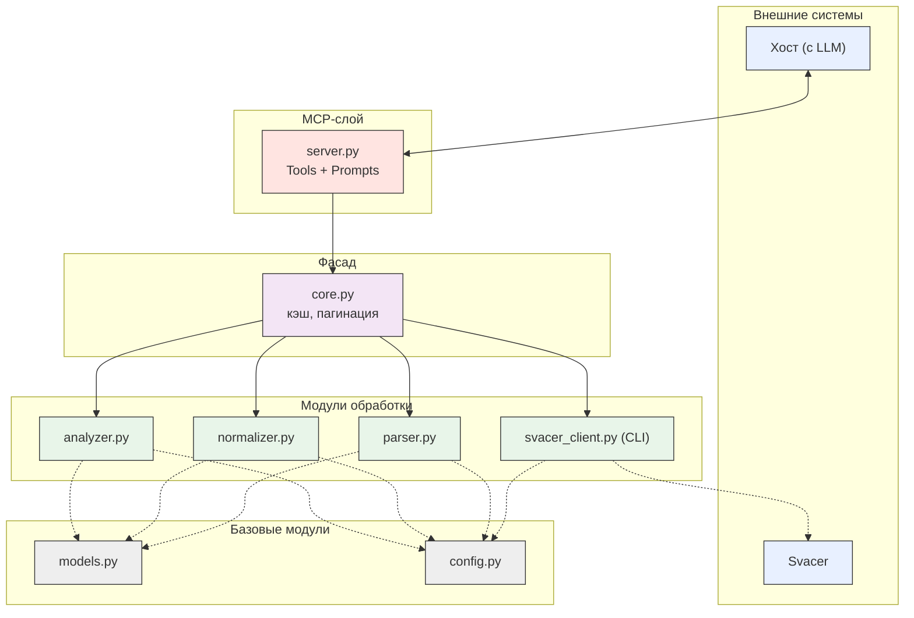

- Определить сценарии использования
- Определить состав обрабатываемых данных
- Спроектировать внутреннюю модель результатов SAST
- Определить список операций MCP-сервера
- Описать способ хранения данных
- Описать границы системы
- Согласовать архитектуру

 ## 1. Сценарии использования
 
 - Все уровни ошибок
 - Только критические ошибки (Critical/Major)
 - Проверка комментариев ревьюеров (Soft Check)
 - Проверка комментариев ревьюеров (Hard Check)
 - Дописывание LLM неоткомментированных findings.

## 2. Состав обрабатываемых данных

 - Входные данные: SARIF в формате JSON. ( команда `svacer sarif2 export --out-` )
 - Выходные данные: Список словарей полей file, line, level, message, rule_id, trace.

## 3. Внутренняя модель результатов SAST
```json
{
    "finding_id": "7P6Pei16cq9IlDbvpqZ5WQ",
    "file": ".build/deflate.c",          
    "line": 287,                          
    "level": "error",                    
    "message": "Memory areas...",         
    "rule_id": "SvEng.CXX.BUFFER_OVERLAP",
    "trace": [                            
        {"file": "...", "line": ..., "message": "..."},
        ...
    ]
}
```
## 4. Список операций MCP-сервера
https://modelcontextprotocol.io/specification/2025-06-18/server/tools

Tools:
1. `get_summary()` — количества по severity, статусу, наличию комментария
2. `get_results(severity, status, has_comment, rule_id, file, offset, limit)` — фильтры и пагинация
3. `get_result(finding_id)` — подробная запись одной ошибки (+ trace и комментарии)
4. `get_rule(rule_id)` — сведения о правиле (имя правила, описание, CWE, критичность по умолчанию)
5. `get_source_fragment(finding_id)` — фрагмент исходных данных, контекст

Promts:
1. `all_errors_audit` (Все уровни ошибок)
- Вызывает:`get_summary`,`get_results`,`get_result`,`get_rule`

2. `critical_errors_audit` (Только критические ошибки)
- Вызывает:`get_results(severity=["Critical", "Major"]`)

3. `soft_check_comments` (Проверка комментариев — Soft)
- Вызывает:`get_results(has_comment=True)`,`get_result`

4. `hard_check_comments` (Проверка комментариев — Hard)
- Вызывает:`get_results(has_comment=True)`,`get_result`

5. `catch_up_report` (Допиcывание отчета)
- Вызывает:`get_results(has_comment=False)`,`get_result`,`get_rule`
   
## Высокоуровневая архитектура


## Декомпозиция компонентов


## Потоки данных
Глоссарий:

### Фаза 1. Выбор prompt

1. Пользователь выбирает prompt в интерфейсе хоста
2. Хост запрашивает текст prompt у `server.py` (MCP `prompts/get`) и получает его
3. Хост передаёт текст LLM
4. LLM по тексту prompt вызывает tool с параметрами через хост. Вызов поступает в `server.py`

### Фаза 2. Подготовка и чтение данных

5. `server.py` принимает вызов, извлекает имя tool и аргументы, передаёт в `core.py`
6. `core.py` берёт ключ источника `(project, branch, snapshot)` из `config.py`. Источник один на процесс сервера, смена ключа требует перезапуска. Проверяет, загружены ли данные в память под этим ключом
7. Если не загружены: ищет файл `data/cache/<ключ>.sarif`. Если файла нет, `svacer_client.export_sarif()` запускает CLI `svacer sarif2 export` (подпроцесс, аргументы списком, учётные данные из переменных окружения) и сохраняет результат в этот файл
8. Подготовка данных:
   - `parser.parse_sarif()` возвращает две структуры: `findings` и `rules`. Связь по `rule_id`
   - `normalizer` приводит `checker_severity` к четырём значениям `severity`, `level` сохраняется
   - `analyzer.deduplicate()`
9. `review_store` загружается один раз, держится в памяти, каждая запись сразу дописывается на диск
10. Обработка по tool:
11. `core.py` возвращает результат в `server.py`, тот упаковывает его в JSON-RPC и отправляет хосту

### Фаза 3. Обработка порции LLM

12. LLM получает срез и метаданные.
13. При необходимости LLM вызывает `get_result`, `get_rule`, `get_source_fragment`. Каждый вызов проходит шаги 5–11 без пагинации
14. LLM формирует запись для каждого finding порции по правилам prompt 
15. LLM вызывает `save_reviews(prompt, records)`:
    - ключ записи `(finding_id, prompt)`, повторная запись перезаписывает предыдущую;
    - запись с несуществующим `finding_id` или недопустимым `verdict` отклоняется, остальные сохраняются;
    - ответ: `{saved, rejected[]}`
16. Очередь: все prompts обрабатывают findings, для которых ещё нет записи по этому prompt (`has_review=false`). Поэтому каждый следующий вызов `get_results` идёт с `offset=0`, набор сокращается по мере сохранения. Если `remaining` не уменьшился после сохранения, LLM останавливается и сообщает пользователю об этом, иначе цикл повторял бы одну и ту же страницу. Возврат к шагу 5, пока `remaining > 0`.
Поведение по prompts:

### Фаза 4. Финализация

17. Когда `remaining = 0`, LLM вызывает `export_report(prompt)`.
18. `review_store` собирает файл `data/reports/<ключ>_<prompt>.md` из записей и данных findings (`finding_id`, `file`, `line`, `rule_id`, `severity`, `verdict`, `text`) и возвращает путь, число записей и счётчики по `verdict`. Каждая строка отчёта содержит `finding_id`, поэтому вывод сопоставляется с исходным SARIF
19. LLM сообщает пользователю итог и путь к файлу
