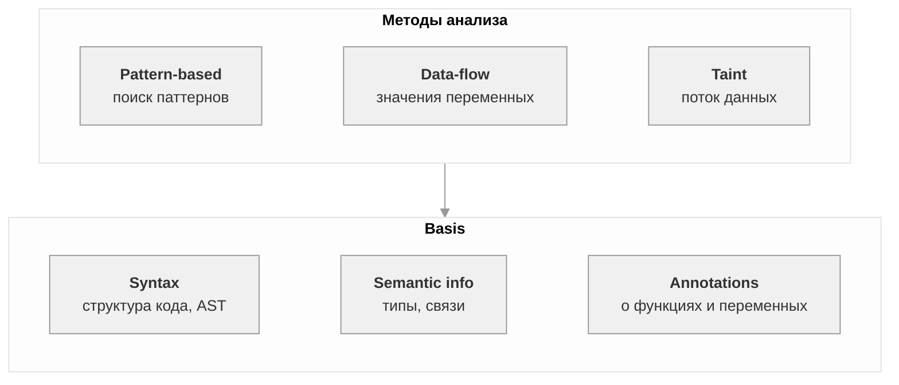

SAST — анализ исходного кода без запуска. Ищет уязвимости и ошибки по таким признакам как: паттерн, структура, поток данных.

Анализатор имеет встроенные правила
Используемый в проекте стат анализатор - Svace.
Svacer − это комплексный пользовательский интерфейс просмотра предупреждений, сервер хранения и управления результатами анализа. Поддерживает многопользовательский режим и различные фильтры данных

## Правило анализа

Правило — инструкция анализатору: что искать и как назвать проблему.
Содержит id, описание, критичность, помощь по исправлению.

### Примеры из SARIF

| id | Описание | Уровень |
|---|---|---|
| B608 | Possible SQL injection | error |
| B101 | Use of assert detected | note |
| ... | ... | ... |

### Где в SARIF

Правила лежат в `runs[0].tool.driver.rules`.
Findings ссылаются на правила через поле `ruleId` в `results`.
