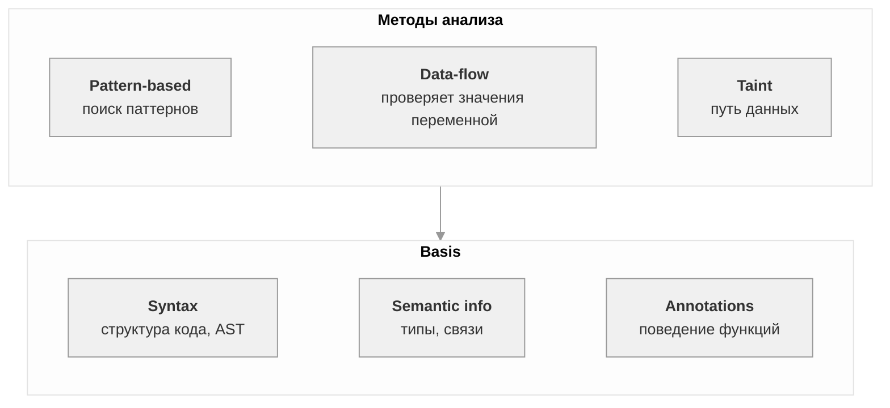

SAST — анализ исходного кода без запуска. Ищет уязвимости по паттернам, значениям переменных и путям данных. На основе этих признаков работают три метода анализа: Pattern-based, Data-flow, Taint. Все они опираются на теоретический фундамент (Basis).
JSON организует данные в виде пар «ключ — значение». 

Используемый в проекте стат анализатор - Svace.
Svacer − это комплексный пользовательский интерфейс просмотра предупреждений, сервер хранения и управления результатами анализа. Поддерживает многопользовательский режим и различные фильтры данных

## Правило анализа

Правило — инструкция анализатору, содержит id, описание, критичность, комментарий.
Примеры: «Переменные должны быть инициализированы перед использованием», «Имена классов должны начинаться с заглавной буквы».
Finding — это одно срабатывание правила. Основная единица данных, с которой работает сервер.

1) Анализатор читает код
2) Строит AST
3) Сопоставляет AST с паттернами из правил
4) Если паттерн совпал — создаёт finding
5) Записывает его в SARIF в массив results

Поля у finding:
- ruleId
- message.text
- level
- locations
- codeFlows
- fingerprints
- properties

## Уровни критичности 
- Critical 
- Major 
- Minor 
- Normal 

У Svacer находятся в разделе properties.severity

## Типы findings по истинности
Помечаются разметкой в Svacer + LLM
- True Positive (TP)
- False Positive (FP) 
- True Negative (TN)
- False Negative (FN)

## Ограничения SAST 
- Ложные срабатывания(FP)
- Пропуски (FN)
- Runtime-проблемы

## Структура трасс в SARIF

result.codeFlows[].threadFlows[].locations[].location

