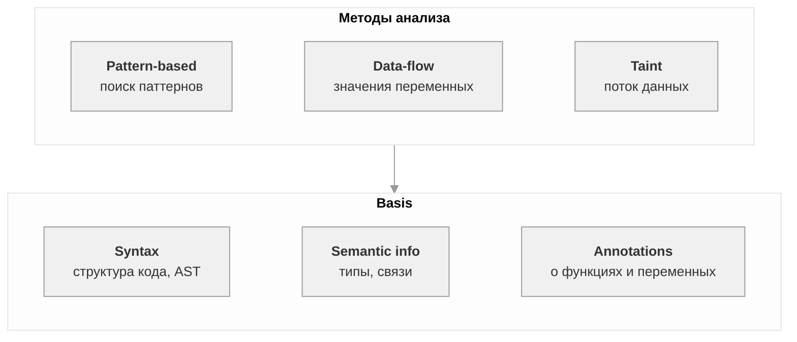

SAST — анализ исходного кода без запуска. Ищет уязвимости и ошибки по таким признакам как: паттерн, структура, поток данных.

Анализатор имеет встроенные правила
Используемый в проекте стат анализатор - Svace.
Svacer − это комплексный пользовательский интерфейс просмотра предупреждений, сервер хранения и управления результатами анализа. Поддерживает многопользовательский режим и различные фильтры данных

## Правило анализа

Правило — инструкция анализатору: что искать и как назвать проблему.
Содержит id, описание, критичность, помощь по исправлению.

Finding — это одно срабатывание правила. Основная единица данных, с которой работает сервер.

1) Анализатор читает код.
2) Строит AST.
3) Сопоставляет AST с паттернами из правил.
4) Если паттерн совпал — создаёт finding.
5) Записывает его в SARIF в массив results.

Поля у finding:
ruleId
message.text
level
locations
codeFlows
fingerprints
properties

## Уровни критичности 
Critical 
Major 
Minor 
Normal 

У Svace находятся в разделе properties.severity

## Типы findings по истинности

